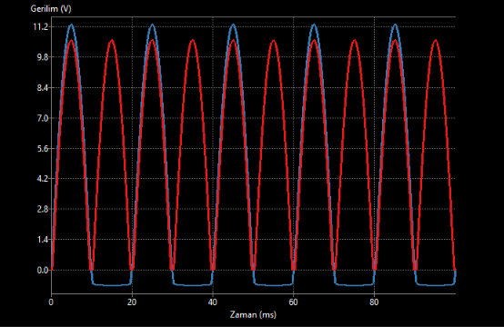
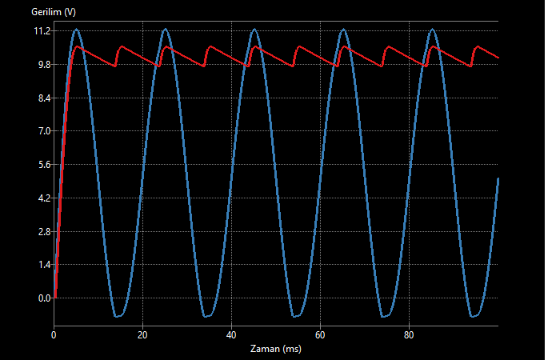
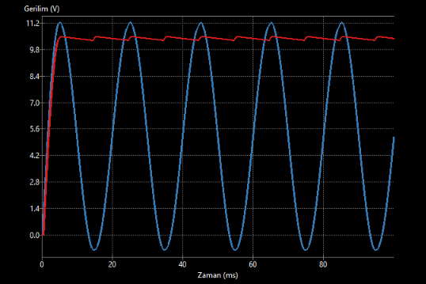
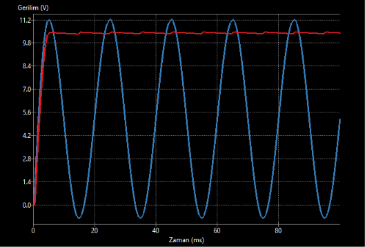

# Full-Wave Bridge Rectifier with Filter Capacitor (KiCad / ngspice)

Simulation of a full-wave bridge rectifier (4 diodes) with a resistive load,
comparing the output ripple for different filter capacitors.

**Status:** simulated in ngspice. Hardware verification: planned.

## Circuit
- Source: 12 V peak, 50 Hz sine
- Load: 1 kΩ
- Filter capacitor: 100 µF / 470 µF / 1000 µF

## Results
Ripple measured with cursors between a peak and the following minimum
(10 mA load, 100 Hz ripple frequency):

| C | Ripple (calculated) | Ripple (simulated) |
|---|---|---|
| 100 µF | ~0.89 V | 845 mV |
| 470 µF | ~0.197 V | 193 mV |
| 1000 µF | ~0.093 V | 90.4 mV |

Ripple estimate: ΔV ≈ I·t / C, where t ≈ 8.5–9 ms is the time the capacitor
discharges between two peaks (slightly less than the 10 ms period, because the
capacitor charges during part of each cycle). At 100 µF the voltage drop is
larger, so the load current decreases slightly and the linear estimate
is a bit high.
## Notes
- The output needs a DC path to ground; with an open output the
  simulation result is not meaningful.

## Images

